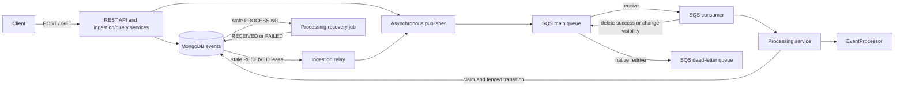
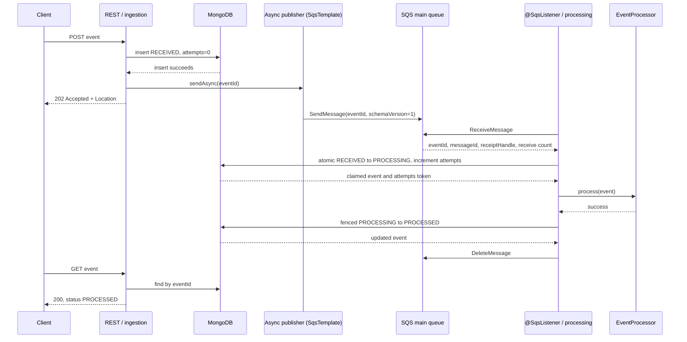
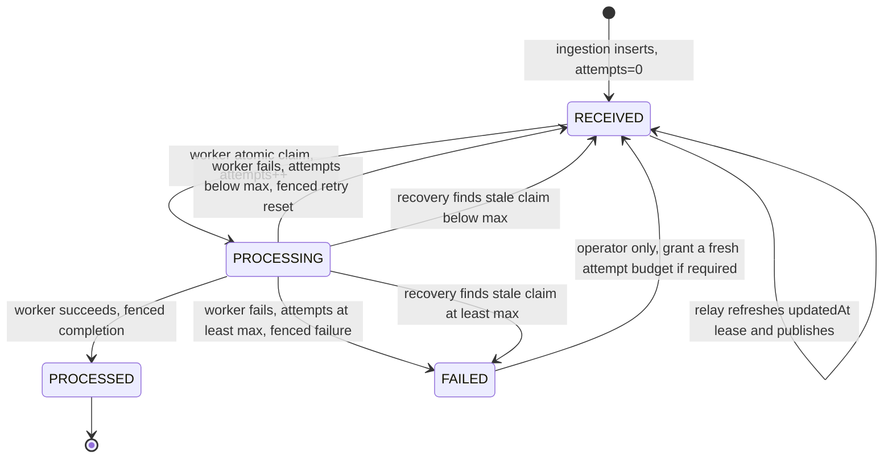
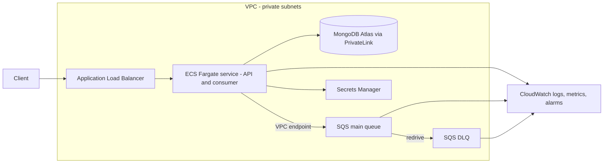

# Architecture

This document describes the implementation in this repository. Items labelled **Proposed for
production** are design options, not deployed infrastructure or implemented features.

### Where each required topic is covered

| Assignment topic | Section |
| --- | --- |
| Architecture diagram, main components | 1, 2 |
| Technology choices (incl. why SQS) | 3 |
| Event lifecycle | 4 |
| MongoDB model, indexes, growth | 5 |
| Duplicate prevention / race conditions | 6 |
| Failure handling, retries, failed messages | 7 (summary matrix in 7.0) |
| Scaling approach and bottlenecks | 9 |
| AWS deployment | 10 |
| Monitoring / observability | 11 |

## 1. Overview

The service accepts events through REST, persists them in MongoDB, and publishes event identifiers
asynchronously to an SQS standard queue. A consumer claims each event in MongoDB, invokes the
processor, and records its outcome. `EventProcessor` currently performs no business effects.

Publication and consumption can race with the HTTP response; the POST body represents the accepted
ingestion result, not a promise that processing has already completed.

## 2. Components and package boundaries

All packages below are under `dev.eventpipeline.service`.

| Package / component | Responsibility |
| --- | --- |
| `api`, `api.dto`, `api.validation`, `api.exception` | REST binding, validation, response DTOs and ProblemDetail errors. |
| `service.ingestion` | Insert-first idempotent ingestion and `ReceivedEventRelay`. |
| `messaging.ingestion` | SQS publisher (Spring Cloud AWS `SqsTemplate`, non-blocking send). |
| `service.query` | Single-event lookup and customer filter/pagination validation. |
| `messaging.processing` | `@SqsListener`: receipt acknowledgement and visibility backoff. Polling, concurrency and shutdown are handled by the Spring Cloud AWS listener container. |
| `service.processing` | Claim/complete/retry orchestration, processor contract, reason sanitization and `StuckProcessingRecovery`. |
| `domain`, `repository` | Shared event model and atomic MongoDB queries/transitions. |
| `config` | Property records, injected Clock, Mongo conversions/schema initialization and shared client construction. |

The ingestion side and processing side communicate only through MongoDB and SQS. In particular,
recovery never calls the publisher; the ingestion relay publishes after recovery resets Mongo
state. `IngestionProcessingSeparationArchTest` checks `api`, `service.ingestion` and
`messaging.ingestion` against `service.processing` and `messaging.processing` in both directions.
Its shared configuration allowance is for settings and infrastructure, not cross-side orchestration.

## 3. Technology choices

* **SQS (standard queue):** managed queueing, at-least-once delivery, receipt visibility timeouts, and native DLQ
  redrive fit independent publishers and consumers. The local initializer creates a standard queue;
  no FIFO flag, message group or deduplication identifier is configured. The API does not promise
  ordering. MongoDB idempotency is still needed for crashes and duplicate requests, so standard
  queue delivery plus idempotent consumers is sufficient for the implemented contract.
  The message carries only the `eventId`; MongoDB remains the source of truth, so messages stay tiny
  and a stale or duplicate message can never carry outdated payload data.

  | Alternative | Why it was not chosen |
  | --- | --- |
  | SQS FIFO | Deduplication window is only 5 minutes and cannot replace durable idempotency; message groups limit throughput; events have no required ordering. |
  | Kafka / MSK | Replayable log and partition ordering are not needed here; much higher operational cost for per-message retry/DLQ semantics. |
  | RabbitMQ / Amazon MQ | Capable, but SQS needs no brokers to operate and has built-in visibility timeout and DLQ redrive. |
  | MongoDB as the queue (polling `RECEIVED`) | Simple, but couples processing load to the primary database and has no native backoff/DLQ. The relay uses this idea only as a safety net. |
  | SNS + SQS | Useful when several independent consumers need each event; unnecessary for a single processing pipeline (see next steps). |
* **MongoDB:** one document holds the payload and lifecycle. Unique `_id` insertion and atomic
  conditional `findAndModify` operations resolve races without an application-wide lock.
* **LocalStack:** provides local SQS for Compose and integration tests. Tests use the pinned 4.14
  image and create queues/redrive themselves; they do not run the Compose initialization script.
* **Java 17 / Spring Boot:** REST validation, Spring Data MongoDB, scheduling and lifecycle-managed
  scheduling provide the application infrastructure. AWS SDK v2 with Spring Cloud AWS (`SqsTemplate`
  to publish, `@SqsListener` to consume) handles SQS.

## 4. Event lifecycle

Worker transitions match `_id`, `status=PROCESSING`, and the attempts value returned by that worker's
claim. Completion records `processedAt` and removes `failureReason`. Automatic processing treats
`FAILED` as terminal; the operator transition is a documented operational action, not an endpoint.
Server-side times use the injected `Clock`; MongoDB date storage has millisecond precision.

## 5. Data model and indexes

The `events` collection stores `Event`; the REST response intentionally exposes fewer fields.

| Document field | BSON representation / role |
| --- | --- |
| `_id` (`eventId`) | String, unique MongoDB primary key. |
| `customerId`, `type`, `currency` | Required strings; `type` is the `EventType` enum (PAYMENT, REFUND) stored by name; currency matches three uppercase letters. |
| `amount` | Required Decimal128, explicitly converted to/from Java BigDecimal. |
| `timestamp` | Required BSON date: client-reported event time. |
| `status` | Required enum: RECEIVED, PROCESSING, PROCESSED or FAILED. |
| `createdAt`, `updatedAt` | Required BSON dates: receive time and latest transition/lease time. |
| `attempts` | Required BSON int32; counts successful claims and fences workers. |
| `processedAt` | Optional BSON date. |
| `failureReason` | Optional string. |
| `metadata` | Optional object. |

`EventCollectionInitializer` creates a strict, error-rejecting `$jsonSchema` validator only when the
collection is absent. It enforces the required fields and BSON types, the status enum, nonempty
`type`, and the currency pattern. Optional fields must have the declared type when present; they are
normally omitted rather than stored as null. Additional properties are allowed.

The validator deliberately does **not** enforce positive amounts, a fixed business type list,
metadata entry limits, nonnegative attempts, legal state transitions, or retry limits. The REST DTO
requires positive amounts with at most 16 integer and 6 fractional digits and bounds metadata and
string sizes; repository transitions enforce the lifecycle. Direct database writes bypass REST rules.

Besides MongoDB's unique `_id` index, initialization creates two custom indexes:

| Index | Query supported |
| --- | --- |
| `{customerId: 1, createdAt: -1}` | Customer equality, optional receive-time range, descending receive-time ordering. Optional status is an additional filter. |
| `{status: 1, updatedAt: 1}` | Relay and recovery status equality, stale-time range and ascending updatedAt selection. |

Customer queries use service-assigned `createdAt`, not the potentially late or inaccurate client
`timestamp`: `from` is inclusive and `to` exclusive. The repository performs a count plus a paged
find, ordered by createdAt descending. Equal createdAt values have no explicit tie-breaker.
An explain test checks that the stale lookup uses the status/updatedAt index without a hint;
returning the full document still requires a fetch, so it is not a projection-only covered query.

Existing collections are left unchanged: startup does not migrate their validator or repair their
indexes. The Compose app user has only `readWrite` on the application database; schema evolution
requires a migration run with an elevated role. As data grows, index storage/cache use, write/index
maintenance, counting and large-offset `skip` pagination become costs. **Proposed:** retention and
archiving, a deliberately chosen TTL policy, and cursor pagination with a stable tie-breaker. None
is implemented; premature deletion would also remove idempotency history and unresolved work.

## 6. Duplicate prevention and races

Ingestion always attempts `insert`, not an upsert or a read-before-insert. Concurrent requests for
one eventId compete on MongoDB's unique `_id`: one insert wins and only that path submits an initial
publication. A duplicate reloads the existing document and compares customerId, type, numeric amount,
currency, timestamp truncated to milliseconds, and metadata (null/absent metadata is treated as empty).

Duplicates are prevented in layers, each covering a different race:

| Layer | Mechanism | Race it closes |
| --- | --- | --- |
| Ingestion | Unique `_id` = `eventId`; insert-first, no read-before-insert | Concurrent identical POSTs |
| Ingestion | Payload comparison on duplicate | Same id, different payload returns 409 |
| Processing | Atomic `RECEIVED` to `PROCESSING` `findAndModify` | Two consumers receiving the same or duplicated message |
| Processing | Fencing on the `attempts` token for complete/retry/fail | Slow worker finishing after recovery re-claimed the event |
| Publication | Relay lease via atomic `updatedAt` refresh | Multiple instances republishing the same stale event |

Identical payloads return 202 with the existing current status, `duplicate=true` and
`Idempotent-Replayed: true`, without another initial publication. A changed payload returns 409
with `urn:problem:event-payload-conflict`.

For message delivery, a single atomic RECEIVED-to-PROCESSING claim increments attempts as int32.
Concurrent consumers cannot both claim the same current state. A later worker must also present its
claim's attempts token when completing, retrying or failing. A stale worker whose update matches
nothing warns and retains the message; it cannot overwrite a newer claim/result.

## 7. Failure handling

### 7.0 Summary of the required failure scenarios

| Scenario | Detection | Response | Final outcome |
| --- | --- | --- | --- |
| Processor fails during processing | Exception from `EventProcessor` | Fenced reset to `RECEIVED`, reason stored, message kept with exponential visibility backoff | Retried; `FAILED` after `maxAttempts` |
| Temporary MongoDB unavailability | Mongo/data-access exception on claim or update | API returns 503 + `Retry-After`; consumer keeps the receipt and backs off; no attempt consumed by a failed claim | Resumes when Mongo returns; relay republishes lost work |
| Duplicate message delivery | Atomic claim finds status not `RECEIVED` | `PROCESSED` is acknowledged; `PROCESSING` is retried later; processor is not run twice | No duplicate processing |
| Repeated failures | Attempts reach `maxAttempts` | Mongo `FAILED`; SQS redrive moves the message to the DLQ | Visible in DLQ for operators |
| Crash during processing | Event stays `PROCESSING` and `updatedAt` goes stale | Recovery job resets to `RECEIVED` (or `FAILED` at the limit); relay republishes | Processed by another instance |
| Crash between insert and send | Event stays `RECEIVED` past the stale threshold | Relay leases and publishes it | Processed normally |

Details follow below.

### Processor fails during processing

After a successful claim, a processor exception consumes that attempt. Before the limit, the worker
conditionally resets PROCESSING to RECEIVED and stores a reason plus updatedAt. The reason contains
the exception class and at most 200 message characters; controls and known event/metadata values are
redacted, and structured or credential-bearing messages are suppressed. This is defensive filtering,
not a guarantee of detecting arbitrary secrets: processor exception messages must remain safe.

The consumer retains the receipt and uses ChangeMessageVisibility rather than sleeping the worker
for the entire retry delay. Success clears any earlier reason and acknowledges the receipt.

### Temporary MongoDB unavailability

The consumer catches translated data-access errors and Mongo driver exceptions on claim/load/state
updates, warns with eventId/messageId, retains the receipt and applies backoff. Only the atomic claim
increments attempts; a failed claim does not invent an attempt. If a claim committed before a later
operation failed, its persisted attempt remains and stale recovery may be needed. Business effects
may have happened before a failed completion write, so the business step must be idempotent.

The listener container backs off and retries failed polls itself. Each job catches failures so a later scheduled tick
can continue. MongoDB errors at the API return a generic 503 ProblemDetail with `Retry-After: 5`;
an insert failure does not submit publication. An ambiguous committed insert can be recovered by the
relay. A message can reach the DLQ during an outage while Mongo still says RECEIVED; relay publication
after Mongo recovers prevents that DLQ copy from becoming lost database work.

### Duplicate message delivery

A PROCESSED event is acknowledged without executing the processor again. A PROCESSING event keeps
its receipt with base backoff, allowing the current worker or recovery to finish. FAILED, unknown
event identifiers and malformed messages are retained for redrive. Expected relay/SQS duplicates
therefore do not overwrite completed state.

### Repeated failures: attempts, backoff, FAILED and DLQ

Defaults are maxAttempts **3**, retry base **5 seconds**, retry cap **60 seconds**. Visibility backoff is
`min(base * 2^(ApproximateReceiveCount - 1), cap)`: delivery count comes from SQS, while attempts counts
Mongo claims. At or above maxAttempts, a fenced worker update marks FAILED and retains the receipt.

**maxAttempts must equal the main queue redrive maxReceiveCount.** Compose passes the same
`PROCESSING_MAX_ATTEMPTS` value to the app and queue initializer; the app does not validate the remote
queue policy at runtime. Operations must preserve this coupling when changing an existing AWS queue.
The LocalStack redrive test observes deliveries 1 through 3, then the next main-queue receive after
visibility expiry transfers the message to the DLQ and returns no message. Merely marking Mongo
FAILED does not move the message. DLQ copies require operational inspection and cleanup/replay.

To reprocess a FAILED event, an operator deliberately resets it to RECEIVED, resets attempts when
granting a fresh budget, and updates its timestamp. The relay republishes after the stale window.
There is no replay endpoint or automated DLQ drain; operators must account for old DLQ copies and
ensure old workers are no longer active before resetting the attempts fencing counter.

### Application crash during processing or between insert and send

The ingestion relay runs every **10 seconds** by fixed delay, leases up to **100** RECEIVED documents
older than **60 seconds**, and refreshes updatedAt atomically before submitting publication. Multiple
instances cannot lease that event in the same stale window. A crash or failed send leaves durable database work eligible again after a stale window. Relay INFO counts
publication submissions, not confirmed SQS delivery; the publisher reports send failures separately.

Processing recovery runs every **10 seconds** and drains PROCESSING documents older than **300
seconds**. Its atomic update resets to RECEIVED below maxAttempts, otherwise marks FAILED. Recovery
does not publish: the extra stale-RECEIVED delay before relay publication is deliberate separation.
Both jobs are independently switchable off. The recovery threshold must exceed SQS visibility timeout
and the maximum expected processing time; this cross-setting requirement is documented, not enforced.

A slow live worker can execute effects again after recovery and re-claim, even though fencing blocks
its later stale write. There is no visibility heartbeat or processing lease renewal. Scheduling,
relay batch backlog and imperfectly synchronized instance clocks also affect recovery latency.

## 8. Delivery guarantee

The implemented model is at-least-once queue delivery with idempotent, fenced database transitions:
effectively-once ownership of the successful state change. It is not an atomic transaction spanning
MongoDB, SQS and external business effects. The business step itself must be idempotent.

## 9. Scaling and bottlenecks

Instances are stateless with respect to durable business data and can compete safely for Mongo claims
and relay leases. Publishing is non-blocking and bounded only by the async client; a failed send leaves
RECEIVED work for the relay. The listener container processes up to 4 messages concurrently by default
(`AWS_SQS_CONSUMER_WORKER_THREADS`), with 20-second long polls and 30-second visibility; slow messages
therefore consume visibility time.

Likely constraints are Mongo write throughput and index maintenance, status/staleness scans, customer
count/page queries and hot customers, queue request/in-flight limits, and slow business processing.
Recovery drains all eligible stale work per run, while relay is batch-limited. No capacity measurements,
load-test results, scaling controller or autoscaling deployment exist in this repository.

### Scaling approach (proposed)

* **API tier:** scale horizontally on CPU/request rate behind the load balancer; instances are stateless.
* **Workers:** scale on queue backlog (`ApproximateNumberOfMessagesVisible` / oldest-message age) rather than CPU,
  since the work is I/O bound. Keep total listener concurrency within what MongoDB can absorb.
* **MongoDB:** vertical scale first, then replica-set reads for queries; shard on `customerId` only if write volume
  requires it (matches the customer query index prefix, avoids a monotonically increasing shard key).
* **Throughput limits:** relay is batch-limited (100 per 10 s per instance) and is a safety net, not the main path.

## 10. AWS deployment — proposed for production

No AWS deployment manifests or infrastructure-as-code are provided. A possible deployment uses an
ALB and ECS Fargate or EKS for the service, SQS main/DLQ queues, and MongoDB Atlas or another compatible
managed database. Amazon DocumentDB compatibility must be verified for the actual `$jsonSchema`,
Decimal128 conversions and aggregation-pipeline findAndModify updates before choosing it.

Use an IAM task/workload role through the existing default AWS credentials provider chain, not static
keys; provision real secrets through Secrets Manager or SSM Parameter Store. Consider private subnets,
VPC endpoints, least-privilege queue permissions, and ALB checks on `/actuator/health`. Queue policy,
visibility, retry coupling, retention, migrations and external database durability need explicit
production configuration and validation. These are proposals, not completed deployments.

## 11. Monitoring and observability

| Implemented now | Proposed for production |
| --- | --- |
| SLF4J text logs with key=value identifiers: eventId on event paths and messageId where a SQS receipt is available; publisher success correlation is DEBUG. No JSON log encoder is configured. | Centralized JSON log ingestion, correlation/tracing across HTTP, queue and business effects. |
| `/actuator/health` is exposed with details hidden and liveness/readiness groups enabled. Only health is exposed over the Actuator web interface; no SQS-specific health contributor is implemented. | Queue depth, oldest-message age, DLQ depth, status/stuck counts and processing-latency metrics; dashboards. |
| WARN messages for safe failure diagnostics; INFO summaries only for nonempty relay/recovery runs. No application-specific metrics/alarms are defined. | Alarms for DLQ depth > 0, growth of RECEIVED/PROCESSING older than thresholds, and API 503 rate. |

Suggested production alerts (proposed): DLQ depth greater than 0; oldest main-queue message older than a few
minutes; events in `RECEIVED` or `PROCESSING` past their stale thresholds; API 5xx/503 rate; processing latency p95.
Suggested custom metrics: events by terminal status, attempts per event, relay/recovery counts per run.

## 12. Trade-offs and next steps

* Mongo-first asynchronous publication keeps POST independent of later SQS send latency, at the cost
  of relay delays and duplicates. Queue lookup is still required during application startup.
* Persisting state and idempotency together simplifies races but grows the events collection and indexes.
* Recovery favors availability after crashes; fencing protects state, not exactly-once business effects.
* The current processor is a no-op; real processing needs an explicit idempotency strategy.
* Next: measured load/capacity tests, stable cursor pagination and retention design, operational DLQ
  tooling, monitoring/tracing, authentication/authorization and a deployment/migration pipeline.
* Compose is a development stack: it exposes local service ports, has no configured Mongo data volume,
  and does not provide production durability or an authenticated REST API.
