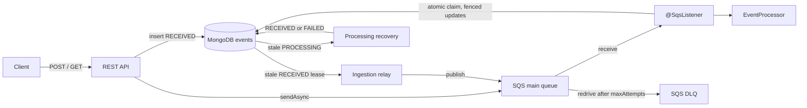
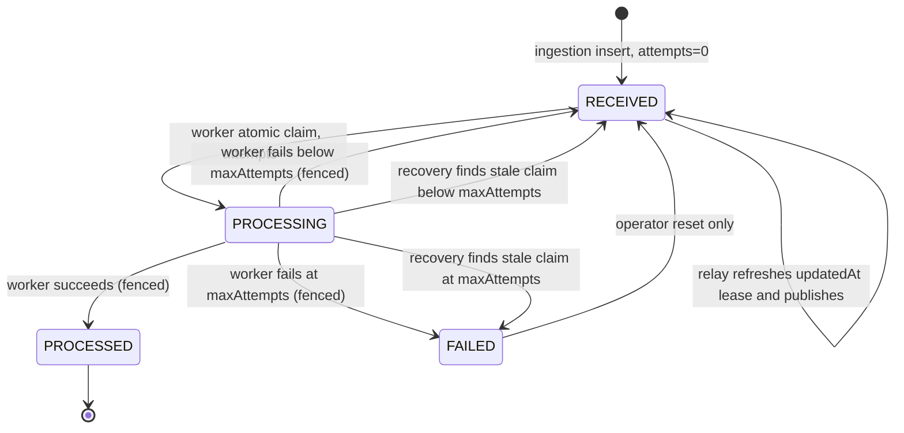

# Architecture

This document describes the implementation in this repository. Anything marked **Proposed** is a
design option for production, not implemented or deployed.

| Assignment topic | Section |
| --- | --- |
| Architecture diagram and components | 1, 2 |
| Technology choices (including why SQS) | 3 |
| Event lifecycle | 4 |
| MongoDB model, indexes, growth | 5 |
| Duplicate prevention and races | 6 |
| Failure handling, retries, failed messages | 7 |
| Scaling and bottlenecks | 9 |
| AWS deployment | 10 |
| Monitoring and observability | 10 |

## 1. Overview

The REST API accepts events, stores them in MongoDB and publishes each event's `eventId` to an SQS
standard queue. A consumer claims the event in MongoDB, runs the processor and records the outcome.
`EventProcessor` is currently a no-op: it performs no business effects.

The POST response reports the ingestion result, not completed processing. Publication and
consumption can finish after the response is sent.

## 2. Components

All packages are under `dev.eventpipeline.service`. The ingestion side and the processing side
communicate only through MongoDB and SQS. Recovery never publishes; the relay publishes after
recovery resets the state. `IngestionProcessingSeparationArchTest` enforces this boundary.

| Component | Responsibility |
| --- | --- |
| `api`, `api.dto`, `api.validation`, `api.exception` | REST binding, validation, RFC 7807 `ProblemDetail` errors. |
| `service.ingestion`, `messaging.ingestion` | Insert-first ingestion, `ReceivedEventRelay`, non-blocking `SqsTemplate` publisher. |
| `service.query` | Single-event lookup and customer filter and pagination validation. |
| `messaging.processing`, `service.processing` | `@SqsListener` receipt handling and visibility backoff; claim, complete, retry and fail orchestration; `StuckProcessingRecovery`. |
| `domain`, `repository` | Event model and atomic MongoDB queries and transitions. |
| `config` | Property records, injected `Clock`, Mongo conversions and collection initialization. |

## 3. Key decisions

| Decision | Choice | Reason | Rejected alternatives |
| --- | --- | --- | --- |
| Queue | SQS standard | Managed, at-least-once delivery, visibility timeouts and native DLQ redrive. Idempotent consumers handle duplicates, so FIFO is not needed. | **FIFO:** 5-minute dedup window, message-group throughput limits, and no ordering requirement. **Kafka / MSK:** replay and partition ordering are not needed, and per-message retry/DLQ costs more to operate. **RabbitMQ / Amazon MQ:** needs brokers to run. **MongoDB polling as the queue:** couples load to the primary and has no native backoff or DLQ (the relay uses this only as a safety net). **SNS + SQS:** useful only with several independent consumers. |
| Message content | `eventId` only | MongoDB is the source of truth, so messages stay small and a stale message cannot carry an outdated payload. | Full payload in the message. |
| Store | MongoDB, one document per event | Unique `_id` and atomic conditional `findAndModify` resolve races without an application lock. | Separate tables for payload and state. |
| Consumer / publisher | `@SqsListener` / `SqsTemplate` (Spring Cloud AWS, AWS SDK v2) | Manual acknowledgement and visibility changes for the retry design; non-blocking send. | Hand-written long-poll loop; custom executor for publishing. |
| Local stack | LocalStack (pinned 4.14) | Local SQS for Compose and integration tests. | Real AWS in tests. |

## 4. Event lifecycle

* Every worker update matches `_id`, `status=PROCESSING` and the `attempts` value from its own claim.
  This fences out stale workers.
* `FAILED` is terminal for automatic processing. Reset is a manual operator action, not an endpoint.
* Server-side timestamps come from the injected `Clock`. MongoDB stores dates with millisecond precision.

## 5. Data model and indexes

The `events` collection stores the `Event` document. The REST response exposes fewer fields.

| Field | Type / role |
| --- | --- |
| `_id` (`eventId`) | String, unique primary key. |
| `customerId`, `type`, `currency` | Required strings. `type` is an `EventType` enum name (PAYMENT, REFUND). Currency is three uppercase letters. |
| `amount` | Required Decimal128, converted to and from `BigDecimal`. |
| `timestamp` | Required date: client-reported event time. Not used for filtering. |
| `createdAt`, `updatedAt` | Required dates: receive time and last transition or lease time. |
| `status` | Required enum: RECEIVED, PROCESSING, PROCESSED, FAILED. |
| `attempts` | Required int32: number of successful claims. Used as the fencing token. |
| `processedAt`, `failureReason`, `metadata` | Optional. |

**Validation.** On creation, `EventCollectionInitializer` installs a strict `$jsonSchema` validator
that checks required fields, BSON types, the status enum, a non-empty `type` and the currency
pattern. Additional properties are allowed. The validator does not check amounts, the type list,
metadata limits, attempt bounds or state transitions. The REST DTO and repository enforce those.
Direct database writes bypass them.

**Indexes.** On every startup, the initializer creates any missing index below. Existing indexes are
left alone.

| Index | Serves |
| --- | --- |
| `{customerId: 1, createdAt: -1}` | Customer queries: equality, optional `createdAt` range and newest-first ordering. |
| `{status: 1, updatedAt: 1}` | Relay and recovery: status plus stale-time range, oldest first. |

Customer queries filter on the service-assigned `createdAt`, not the client `timestamp`. `from` is
inclusive and `to` is exclusive. Equal `createdAt` values have no tie-breaker.

**Growth.** Index size, write cost, counts and large-offset `skip` pagination grow with data.
**Proposed:** retention or archiving, a TTL policy chosen with the idempotency history in mind, and
cursor pagination with a unique tie-breaker. None is implemented.

**Migrations.** Startup does not change the validator of an existing collection. The Compose app user
has only `readWrite`, so schema changes need a migration run with an elevated role.

## 6. Duplicate prevention and races

Ingestion always attempts an `insert`; there is no read-before-insert. Duplicates are caught at each
layer, and each layer covers a different race:

| Layer | Mechanism | Race it closes |
| --- | --- | --- |
| Ingestion | Unique `_id`, insert-first | Concurrent identical POSTs. Only the winning insert publishes. |
| Ingestion | Payload comparison on duplicate | Same `eventId`, different payload: 409. |
| Processing | Atomic `RECEIVED` → `PROCESSING` | Two consumers receiving the same message. |
| Processing | Fencing on `attempts` | A slow worker finishing after recovery re-claimed the event. |
| Publication | Atomic `updatedAt` lease | Several relay instances publishing the same stale event. |

A duplicate POST with the same payload returns 202 with `duplicate=true`, the current status and
`Idempotent-Replayed: true`, and it does not publish again. A changed payload returns 409 with
`urn:problem:event-payload-conflict`. The comparison covers customerId, type, amount, currency,
timestamp (to the millisecond) and metadata; absent metadata counts as empty.

A stale worker whose update matches nothing logs a warning and keeps its message. It cannot overwrite
a newer claim or result.

## 7. Failure handling

| Scenario | Detection | Response | Outcome |
| --- | --- | --- | --- |
| Processor fails | Exception from `EventProcessor` | Fenced reset to `RECEIVED` with a sanitized reason. The message is kept with a visibility backoff. | Retried, then `FAILED` at `maxAttempts`. |
| MongoDB unavailable | Data-access or driver exception | API returns 503 with `Retry-After: 5`. The consumer keeps the receipt and backs off. A failed claim consumes no attempt. | Resumes when Mongo returns. The relay republishes lost work. |
| Duplicate delivery | Claim finds status not `RECEIVED` | `PROCESSED` is acknowledged. `PROCESSING` is retried later. `FAILED` and malformed messages are kept for redrive. | The processor does not run twice. |
| Repeated failures | `attempts` reaches `maxAttempts` | Mongo `FAILED`. SQS redrive moves the message to the DLQ. | Operators inspect the DLQ. |
| Crash during processing | `PROCESSING` goes stale | Recovery resets to `RECEIVED` or `FAILED`. The relay republishes. | Another instance processes it. |
| Crash between insert and send | `RECEIVED` goes stale | Relay leases and publishes it. | Processed normally. |

**Rules behind the table**

* **Attempts vs. deliveries.** Only a successful claim increments `attempts`. The delivery count comes
  from SQS (`ApproximateReceiveCount`). The two are separate: a claim that committed before a later
  failure keeps its attempt.
* **Retry backoff.** Visibility delay is `min(base × 2^(receiveCount − 1), cap)`, using "equal jitter":
  a random value between half the ceiling and the full ceiling, never below 1 second. This spreads out
  messages that failed together. Defaults: base 5 s, cap 60 s.
* **Sanitized reasons.** `failureReason` holds the exception class and up to 200 characters. Control
  characters, known event values and credential-like text are removed. This is best-effort filtering,
  not a secret scanner, so processor exception messages must stay safe.
* **Business effects.** A failed completion write can come after the business step has run. The
  business step must be idempotent.
* **Relay batching.** The relay publishes at most 100 events per run, so a large backlog takes several
  runs to drain.
* **API errors.** Standard MVC errors (unknown route 404, unsupported method 405 with `Allow`) keep their
  status. Application errors use `ApiException`, which carries a stable `urn:problem:*` type.

**maxAttempts and the DLQ.** Defaults: `maxAttempts` 3. **`maxAttempts` must equal the main queue's
`maxReceiveCount`.** Compose sets both from `PROCESSING_MAX_ATTEMPTS`. The app does not validate the
queue policy at runtime, so operators must keep them in step when changing an existing AWS queue. A
message moves to the DLQ only when SQS redrives it, not when Mongo is marked `FAILED`.

**Recovering a FAILED event.** An operator resets the event to `RECEIVED`, resets `attempts` if a fresh
budget is needed, and updates `updatedAt`. Before resetting `attempts`, confirm no old worker is still
active. Old DLQ copies must be handled separately. There is no replay endpoint or automatic DLQ drain.

**Timing.**

| Job | Interval | Stale threshold | Notes |
| --- | --- | --- | --- |
| Ingestion relay | 10 s | 60 s `RECEIVED` | Leases up to 100 events per run. Its INFO log counts submissions, not confirmed deliveries. |
| Processing recovery | 10 s | 300 s `PROCESSING` | Drains all eligible events per run. Does not publish. |

The recovery threshold must be longer than the SQS visibility timeout and the longest expected
processing time. This is documented but not enforced. Both jobs can be turned off independently.

**Known gap.** A slow live worker can run the business step again after recovery re-claims the event.
Fencing blocks its late write, but there is no visibility heartbeat or lease renewal.

## 8. Delivery guarantee

At-least-once queue delivery plus idempotent, fenced database transitions. The result is effectively
once for the successful state change. It is not one atomic transaction spanning MongoDB, SQS and
external effects.

## 9. Scaling and bottlenecks

Instances hold no durable state and can compete safely for claims and relay leases. The listener
handles up to 4 messages concurrently by default (`AWS_SQS_CONSUMER_WORKER_THREADS`) with 20-second long
polls and 30-second visibility. Slow processing therefore uses up visibility time.

Likely limits: MongoDB write throughput and index maintenance, stale-status scans, customer count and
page queries (including hot customers), SQS request and in-flight limits, and slow business processing.
No load tests, capacity measurements or autoscaling exist in this repository.

**Proposed:**
* **API:** scale horizontally on CPU or request rate. Instances are stateless.
* **Workers:** scale on queue backlog (visible messages or oldest message age), since the work is I/O
  bound. Keep total listener concurrency within what MongoDB can handle.
* **MongoDB:** scale up first, then add replica-set reads. Shard on `customerId` only if write volume
  requires it, because it matches the customer index prefix.

## 10. Deployment and observability

**Implemented.** Compose for local development (it exposes local ports, has no Mongo data volume and
is not production-grade). Actuator `/actuator/health` with liveness and readiness groups, details hidden.
SLF4J text logs with `eventId` and `messageId` as key=value fields. WARN for safe failure diagnostics,
INFO for non-empty relay and recovery runs. No JSON log encoder, custom metrics, alarms or AWS
manifests exist.

**Proposed production deployment.** An ALB in front of ECS Fargate (or EKS) running the API and
consumer. SQS main queue and DLQ reached through VPC endpoints. MongoDB Atlas via PrivateLink, or another
compatible service. Verify Amazon DocumentDB supports the `$jsonSchema` validator, Decimal128 and
pipeline-style `findAndModify` before choosing it. Use an IAM task role through the default credentials
chain, and store secrets in Secrets Manager or SSM Parameter Store. Add private subnets, least-privilege
queue permissions and ALB health checks on `/actuator/health`.

**Proposed alerts and metrics.**
* Alert when DLQ depth is above 0, the oldest main-queue message is older than a few minutes, events
  stay `RECEIVED` or `PROCESSING` past their thresholds, API 503 rate rises, or processing p95 latency
  rises.
* Metrics: events by terminal status, attempts per event, relay and recovery counts per run, and queue
  depth and age.
* Centralized JSON logs and tracing across HTTP, queue and business effects.

## 11. Trade-offs and next steps

* Publishing after the Mongo insert keeps POST independent of SQS latency. The cost is relay delay and
  possible duplicate publishes.
* Storing state and idempotency in one collection keeps races simple, but the collection and its
  indexes grow over time.
* Recovery favours availability after a crash. Fencing protects state, not exactly-once business
  effects.
* `EventProcessor` is a no-op. A real processor needs its own idempotency strategy.
* **Next:** load and capacity tests, cursor pagination and retention design, DLQ tooling, tracing,
  authentication and authorization, and a deployment and migration pipeline.
